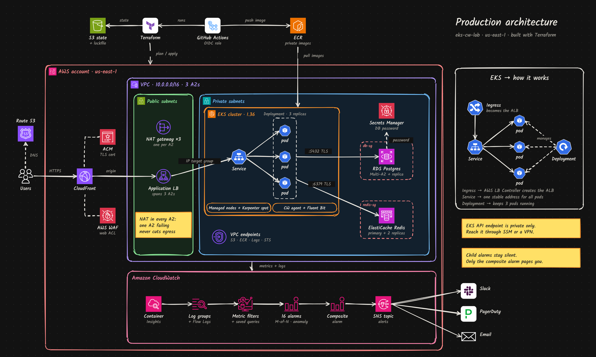
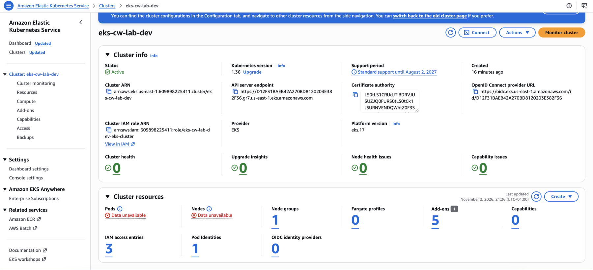
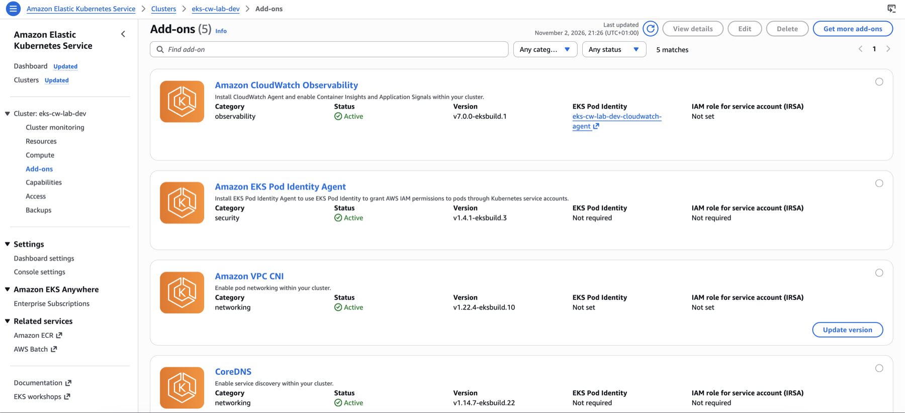
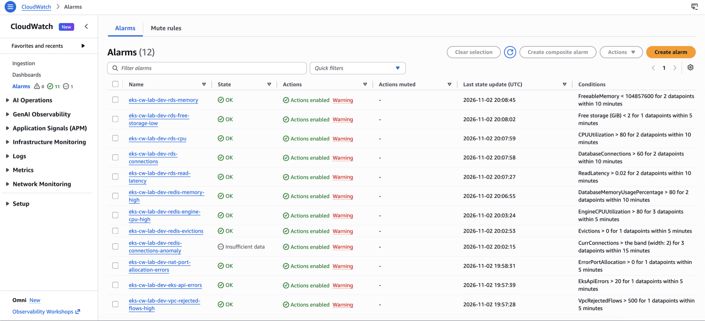
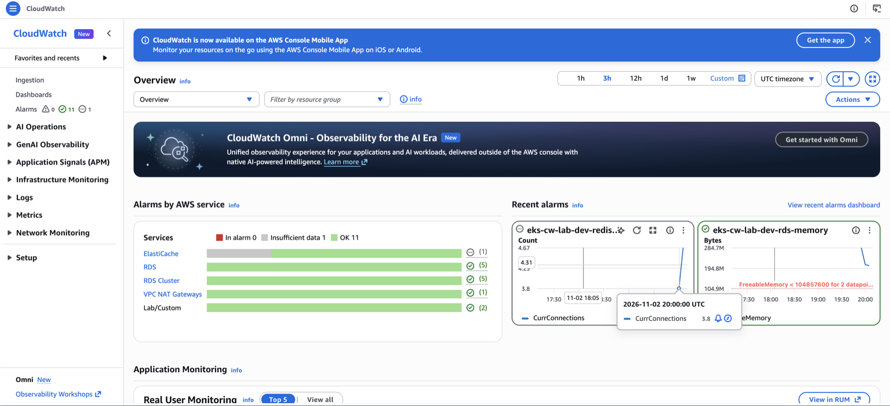
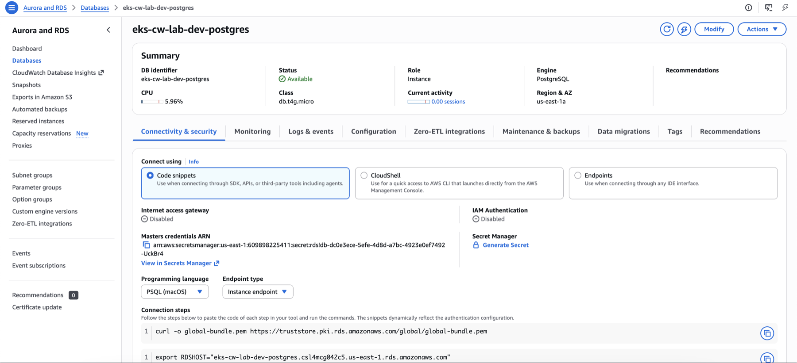
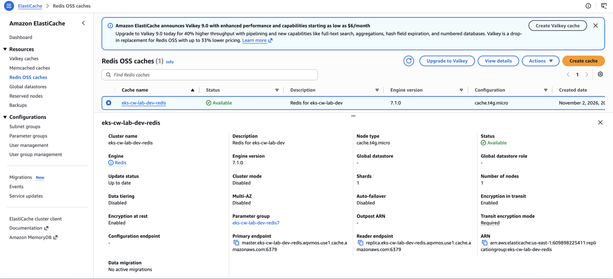
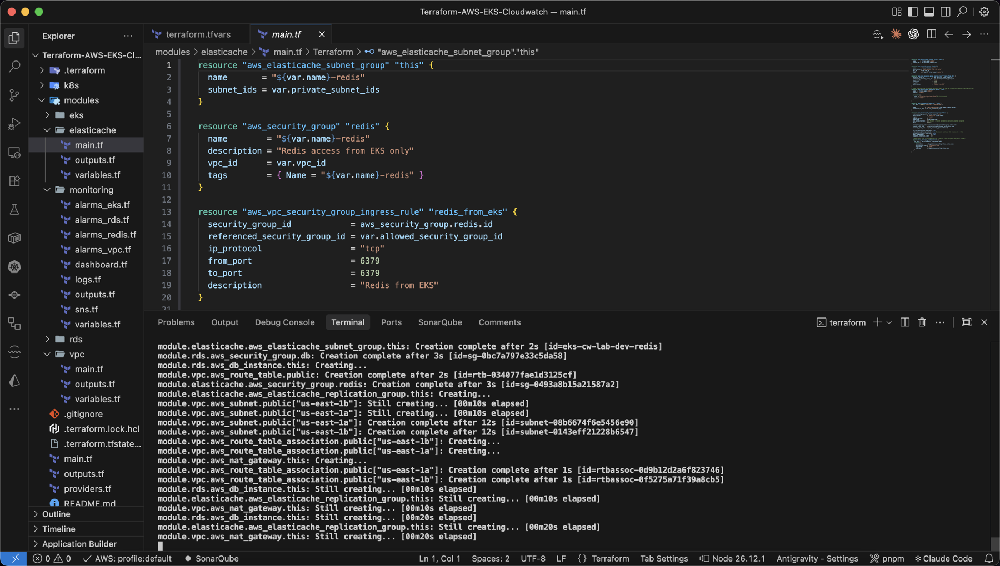
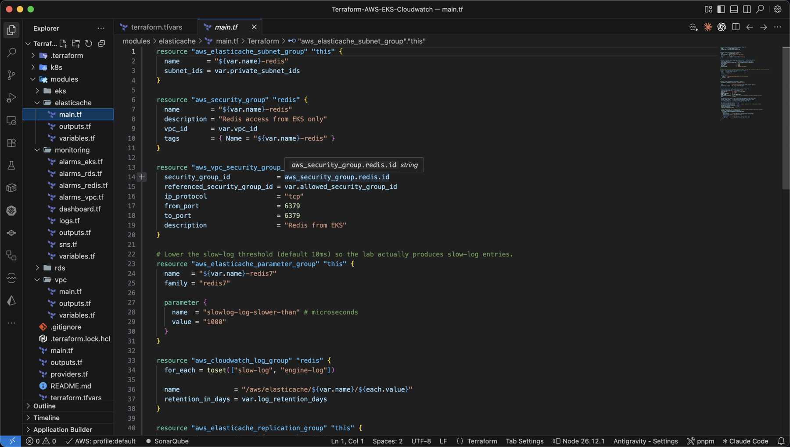

# AWS EKS Observability Platform: Terraform, Kubernetes, CloudWatch

[](https://github.com/dollarsmoney/AWS-EKS-Observability-Terraform-Kubernetes-Cloudwatch-/actions/workflows/ci.yml)


I built this stack from raw Terraform resources, with no community modules. It runs a private **Amazon EKS** cluster, **RDS PostgreSQL** and **ElastiCache Redis**, and an **Amazon CloudWatch** layer monitors all of it: metrics, logs, alarms, dashboards and alert routing. I deployed it to a real AWS account (99 resources). A GitHub Actions pipeline lints it, runs security scans, and runs `terraform plan` against the live state.



> The diagram shows the **production target design**. The deployed lab runs a cost-reduced version of it: 2 AZs, one NAT gateway and single-node data stores. The [roadmap](#production-roadmap) lists the gap between the two.

---

## What this project demonstrates

| Area | What I did |
|---|---|
| **Infrastructure as Code** | 5 reusable Terraform modules (VPC, EKS, RDS, ElastiCache, monitoring) with input validation, `for_each`-driven resources and a remote S3 backend with native locking |
| **Kubernetes on AWS** | EKS 1.36 in private subnets, managed node group, access entries (API auth mode), EKS add-ons, and **Pod Identity** for workload IAM |
| **Observability** | Container Insights, control-plane logs, VPC Flow Logs, RDS and Redis log exports, **16 alarms + 1 composite alarm**, metric filters, saved Logs Insights queries, and a CloudWatch dashboard written as code |
| **Security** | Least-privilege security groups (data tier reachable only from the cluster SG), DB password in Secrets Manager (never in state), encryption at rest and in transit, EKS API locked to an allow-list |
| **CI/CD & DevSecOps** | GitHub Actions: fmt/validate/TFLint, Trivy, Checkov (SAST), SonarQube, OWASP ZAP (DAST), and `terraform plan` via **OIDC**, with no stored AWS keys |
| **Cost awareness** | Small instance sizes, log retention on every log group, and `upgrade_policy = STANDARD` to avoid EKS extended-support pricing |

## Tech stack

**AWS:** VPC, NAT Gateway, EKS, EC2, RDS PostgreSQL 17, ElastiCache Redis 7, CloudWatch (Metrics, Logs, Alarms, Dashboards, Container Insights, Logs Insights), SNS, Secrets Manager, IAM, S3
**Tooling:** Terraform 1.16, kubectl, GitHub Actions, TFLint, Trivy, Checkov, SonarQube Cloud, OWASP ZAP

---

## Observability highlights

All of this lives in [`modules/monitoring`](modules/monitoring):

- **Alarm techniques** (a sample is below; the full list is in the module):
  - **"M out of N" evaluation**, so short spikes don't page anyone (`eks-node-cpu-high`: 3 of 5 datapoints).
  - **Metric math**: free storage is converted from bytes to GiB, so the threshold reads naturally.
  - **Metrics Insights (SQL) alarm**: container restarts are summed across *every* pod with one query.
  - **Anomaly detection**: Redis connections are compared against a learned band.
  - **Composite alarm** `app-tier-unhealthy`, which rolls EKS, RDS and Redis CPU into one page.
- **Logs → metrics:** metric filters turn Flow Log `REJECT` records and Kubernetes API 403/5xx responses into custom metrics, and both have alarms.
- **Saved Logs Insights queries:** top rejected sources, slow Postgres queries, Kubernetes audit events by user, container errors, slow Redis commands.
- **Dashboard as code:** built with `jsonencode()`. It covers EKS, RDS, Redis, NAT and the custom metrics, and includes live log widgets.
- **Retention control:** every log group is pre-created with retention *before* the service writes to it. Without this, EKS, RDS and Fluent Bit create their groups as "never expire".

## CI/CD & security pipeline

[`.github/workflows/ci.yml`](.github/workflows/ci.yml) runs on every push and pull request:

| Stage | Tool | What it checks |
|---|---|---|
| Lint | `terraform fmt`, `validate`, **TFLint** (AWS ruleset) | Formatting, syntax, provider-specific mistakes |
| IaC scan | **Trivy** | Misconfigurations in Terraform and Kubernetes manifests; **secret scanning blocks the build** |
| SAST | **Checkov** | Policy-as-code checks on Terraform, Kubernetes and the workflow itself |
| Code quality | **SonarQube Cloud** | Code smells, security hotspots, quality gate |
| DAST | **OWASP ZAP** baseline | Runs against a live URL once an app is exposed (`DAST_TARGET_URL`) |
| Plan | `terraform plan` via **GitHub OIDC** | Shows exactly which resources would change: in the job summary, as a PR comment, and as an artifact |

Trivy and Checkov results go to the repository's **Security → Code scanning** tab. The plan job assumes a **read-only IAM role** that trusts only this repository, so CI can see the infrastructure but cannot change it.

The scanners report findings without failing the build, because the lab keeps some cost-driven trade-offs on purpose (single-AZ database, public EKS endpoint). Each one maps to an item on the [roadmap](#production-roadmap).

---

## Screenshots

**EKS cluster:** Kubernetes 1.36, Active, in standard support


**EKS add-ons:** CloudWatch Observability authorized through EKS Pod Identity


**CloudWatch alarms:** all created by Terraform


**CloudWatch overview:** alarms grouped by service, including the custom `Lab/Custom` namespace


**RDS PostgreSQL:** private, password managed by Secrets Manager


**ElastiCache Redis:** encryption in transit and at rest, custom parameter group


**Terraform apply**


**Module code**


---

## Problems I hit and how I solved them

1. **EKS rejected the API allow-list.** `InvalidParameterException: CIDRs are not allowed in publicAccessCidrs`. The value was a copy-pasted documentation IP (`203.0.113.0/24` is reserved). I added a Terraform `validation` block that rejects the documentation ranges at `plan` time, before anything gets created.
2. **kubectl timed out about half the time.** My ISP sends traffic out through several public IPs. I confirmed it by calling the check-IP service repeatedly and seeing three different addresses, while the EKS endpoint only allowed one of them. The fix is an allow-list that covers the ISP range; the production fix is a private endpoint behind SSM or a VPN.
3. **Avoiding EKS extended-support charges.** Older Kubernetes versions cost about 6× more per hour in extended support. I used the AWS CLI to check which versions were in standard support, pinned 1.36, and set `upgrade_policy { support_type = "STANDARD" }`.
4. **Log groups that never expire.** EKS, RDS and Fluent Bit create their log groups with no retention. Pre-creating each group in Terraform, with `depends_on`, puts retention under code control.
5. **Keeping secrets out of public CI logs.** I marked `alert_email` and `my_ip_cidr` as `sensitive`, so Terraform redacts them in plan output, and passed them through GitHub variables and secrets instead of committing them.

---

## Project structure

```
.
├── bootstrap/            # one-time: S3 state bucket + read-only GitHub OIDC role for CI
├── modules/
│   ├── vpc/              # VPC, public/private subnets, NAT, VPC Flow Logs
│   ├── eks/              # cluster, node group, add-ons, Pod Identity, log groups
│   ├── rds/              # PostgreSQL 17, parameter group, Enhanced Monitoring
│   ├── elasticache/      # Redis 7, TLS, slow/engine log delivery
│   └── monitoring/       # SNS, alarms, metric filters, Logs Insights queries, dashboard
├── k8s/                  # workloads that trigger alarms on purpose (CPU stress, crash loop, pgbench, redis-benchmark)
├── docs/
│   ├── LAB-GUIDE.md      # hands-on CloudWatch exercises
│   ├── images/           # architecture + screenshots
│   └── *.excalidraw      # editable architecture diagrams
├── .github/workflows/ci.yml
└── main.tf, variables.tf, outputs.tf, versions.tf, providers.tf
```

## Quick start

```bash
# 1. One-time: state bucket + CI role
cd bootstrap && terraform init && terraform apply && cd ..

# 2. Configure
cp terraform.tfvars.example terraform.tfvars   # alert_email, my_ip_cidr

# 3. Deploy (~20 min)
terraform init -backend-config="bucket=$(terraform -chdir=bootstrap output -raw state_bucket)"
terraform apply
$(terraform output -raw configure_kubectl) && kubectl get nodes

# 4. Tear down when finished
terraform destroy
```

**Cost:** about $8–10/day while running (EKS control plane, NAT gateway, 2× t3.small, db.t4g.micro, cache.t4g.micro). Destroy it between sessions.

For exercises that trigger each alarm, see the **[lab guide](docs/LAB-GUIDE.md)**.

## Production roadmap

| Lab today | Production |
|---|---|
| 2 AZs, 1 NAT gateway | 3 AZs, NAT gateway per AZ |
| Public EKS endpoint (allow-listed) | Private endpoint, access through SSM or VPN |
| Single-AZ RDS, single Redis node | Multi-AZ RDS + read replica, Redis replicas with auto-failover |
| No ingress | Route 53 → CloudFront + WAF → ALB (AWS Load Balancer Controller) |
| Every alarm emails | Only the composite alarm pages (Slack/PagerDuty); runbook links in every alarm |
| Plan-only CI | Gated `apply` on merge, one AWS account per environment |

---

*Diagram icons: AWS Architecture Icons; Kubernetes icons by the Kubernetes Authors (CC BY 4.0); Simple Icons (CC0).*
